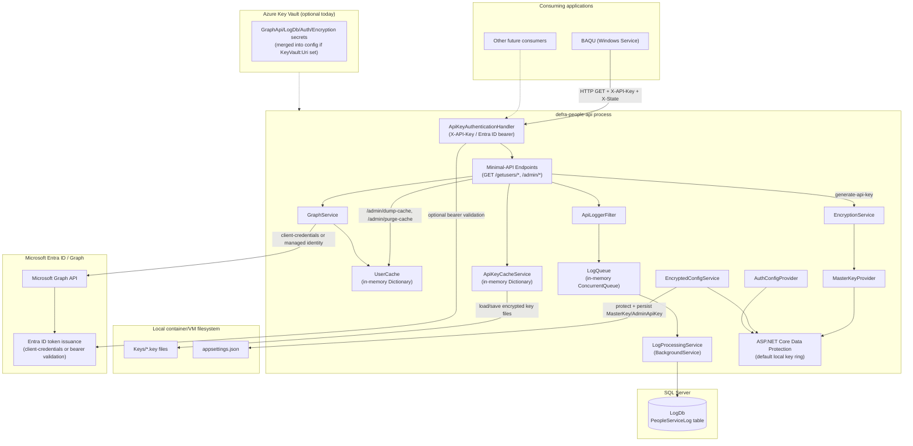
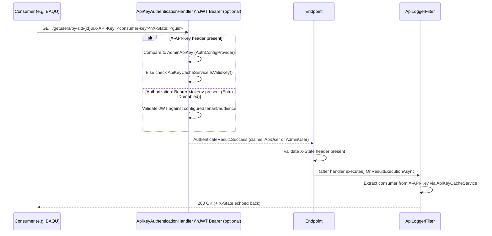
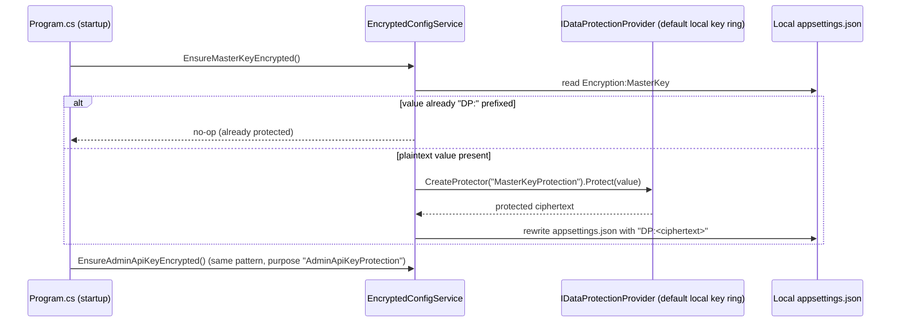
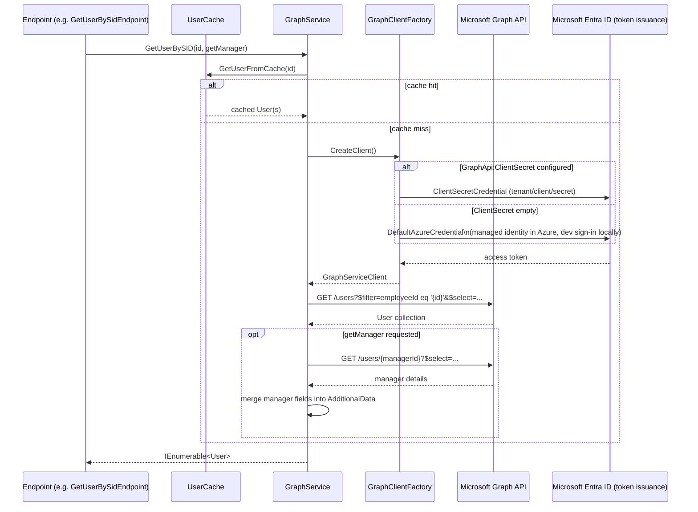
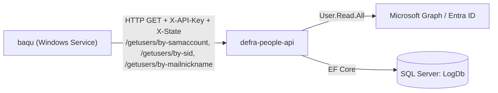
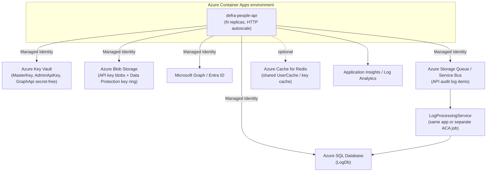

# Technical Low-Level Design — Defra People API (Before Migration Baseline)

**Scope of this document**: this is a read-only study of `defra-people-api` **as it exists on `main`, prior to any cloud-native hardening work** (local API-key file storage, local Data Protection key ring, appsettings.json write-back). It exists to build a shared understanding of every component's purpose/intent *before* deciding which Azure managed services should replace which parts when the app is re-platformed onto Azure Container Apps (ACA) / App Service. No application code is changed by this document.

---

## 1. Purpose of the service

`defra-people-api` is a thin ASP.NET Core (.NET 8 at time of writing, since updated to .NET 10) API that:

1. Resolves "who is this person" (display name, manager, employee details) from **Microsoft Entra ID / Microsoft Graph**, keyed by SID, SAM account name, or mail nickname.
2. Issues and validates **per-consumer API keys** so that only approved internal apps (confirmed consumer today: `baqu`) can call it.
3. Asynchronously logs every API call to a SQL Server database for audit/operational visibility.

It is a single, stateless-looking ASP.NET Core minimal-API process — but several of its components are **not actually stateless**, which is the central theme of this document (see §9).

---

## 2. High-level component diagram



Key takeaway from this diagram: **three components reach outside the process to shared/durable state** — Microsoft Graph (AD), SQL Server (LogDb), and the **local filesystem** (`Keys/*.key` + `appsettings.json`). The local filesystem usage is the one that doesn't map cleanly onto a horizontally-scaled container platform, which is why it's called out explicitly throughout this document.

---

## 3. Component inventory

| Area | Component | File | Responsibility |
|---|---|---|---|
| Hosting/composition | `Program.cs` | `Program.cs` | Builds the DI container, wires auth, registers endpoints, runs startup tasks (`LoadKeysFromDirectory`, `EnsureMasterKeyEncrypted`, `EnsureAdminApiKeyEncrypted`) |
| Auth | `ApiKeyAuthenticationHandler` | `Services/Keys/ApiKeyAuthenticationHandler.cs` | Validates `X-API-Key` header against the admin key or the in-memory consumer-key cache |
| Auth | Entra ID JWT bearer (`AddJwtBearer` + `AddPolicyScheme`) | `Program.cs` | Optional, additive bearer-token auth when `AzureAd:TenantId`/`Audience` configured; chosen per-request based on `Authorization` header shape |
| Auth | `AuthConfigProvider` | `Services/Keys/AuthConfigProvider.cs` | Reads `Authentication:AdminApiKey` from config, unprotecting it via Data Protection if it was previously protected |
| Cache | `ApiKeyCacheService` | `Cache/ApiKeyCacheService.cs` | In-memory `Dictionary<string, AccessKey>` of valid consumer API keys, loaded from/persisted to **local `Keys/*.key` files** |
| Cache | `UserCache` | `Cache/UserCache.cs` | In-memory `Dictionary<string, User>` caching Microsoft Graph user lookups by employeeId/SAM/mail-nickname |
| Crypto | `EncryptionService` | `Services/Crypto/EncryptionService.cs` | AES-encrypts/decrypts each issued API key; encrypts the per-key AES key with a master-key-derived key |
| Crypto | `MasterKeyProvider` | `Services/Crypto/MasterKeyProvider.cs` | Supplies the master key used to derive the AES key/IV in `EncryptionService`; unprotects it via Data Protection if it was DP-protected |
| Crypto | `EncryptedConfigService` | `Services/Crypto/EncryptedConfigService.cs` | One-time, at-rest protection of `Encryption:MasterKey` / `Authentication:AdminApiKey` using Data Protection, **writing the protected value back into the local `appsettings.json` file** |
| Keys | `ApiKeyGenerator` (static) | `Services/Keys/ApiKeyGenerator.cs` | Generates the random, prefixed API key string returned to a new consumer (used by the live `generate-api-key` endpoint) |
| Keys | `ApiKeyGeneratorService` / `IRandomGenerator` | `Services/Keys/ApiKeyGeneratorService.cs`, `RandomGenerator.cs` | An injectable, testable equivalent of `ApiKeyGenerator` — present in the codebase but **not currently wired into the endpoint** (dead code / incomplete refactor) |
| AD/Graph | `GraphClientFactory` | `Services/Graph/GraphClientFactory.cs` | Builds a `GraphServiceClient` using `ClientSecretCredential` (if `GraphApi:ClientSecret` set) or `DefaultAzureCredential`/managed identity otherwise |
| AD/Graph | `GraphService` | `Services/Graph/GraphService.cs` + `Queries/*.cs` | Looks up users by SID/SAM/mail-nickname, optionally expands manager, enriches manager display fields, uses `UserCache` first |
| Logging | `ApiLoggerFilter` | `Services/ApiLogger/ApiLoggerFilter.cs` | `IAsyncResultFilter` that captures method/endpoint/consumer/params/response for every request and enqueues a `LogItem` |
| Logging | `LogQueue` | `Services/ApiLogger/LogQueue.cs` | In-memory `ConcurrentQueue<LogItem>` — the hand-off between the HTTP request and the background writer |
| Logging | `LogProcessingService` | `Services/ApiLogger/LogProcessingService.cs` | `BackgroundService` that drains `LogQueue` and persists each `LogItem` to SQL Server, with exponential-backoff retry |
| Data | `LogDbContext` | `Repository/LogDbContext.cs` | EF Core `DbContext` mapping `LogItem` → SQL Server table `PeopleServiceLog` |
| Health | `DatabaseHealthCheck`, `GraphApiHealthCheck` | `HealthChecks/*.cs` | Back `/health/ready` — verify SQL connectivity and a lightweight Graph call |
| Endpoints | `Endpoints/GET/*`, `Endpoints/POST/*` | `Endpoints/**` | Minimal-API route registrations (see §8 for the full table) |

---

## 4. Authentication & request flow



Notes:
- `X-State` is a caller-supplied, per-request opaque value that the API simply echoes back — a response-integrity/anti-replay correlation token, not a security boundary by itself.
- Admin-only endpoints (`/admin/generate-api-key`, `/admin/refresh-api-keys`, `/admin/purge-cache`) additionally require the `Admin` authorization policy, which compares the raw `X-API-Key` value against the configured `Authentication:AdminApiKey` — possession of an ordinary consumer key is **not** sufficient.
- Entra ID bearer-token auth is **additive and opt-in**: it only activates when `AzureAd:TenantId`/`Audience` are configured; existing `X-API-Key` consumers are unaffected.

---

## 5. Encryption / decryption design

Two independent cryptographic concerns exist in this codebase — don't conflate them:

### 5.1 Per-consumer API key encryption at rest (`EncryptionService` + `MasterKeyProvider`)

```mermaid
sequenceDiagram
    participant Admin as Admin caller
    participant EP as GenerateApiKeyEndpoint
    participant Gen as ApiKeyGenerator
    participant Cache as ApiKeyCacheService
    participant Enc as EncryptionService
    participant MKP as MasterKeyProvider
    participant Disk as Local Keys/ directory

    Admin->>EP: POST /admin/generate-api-key {consumer, issuer, ...}
    EP->>Gen: GenerateApiKeyWithPrefix(consumer)
    Gen-->>EP: "{consumer}_{random base64}"
    EP->>Cache: SaveKeyToFile(AccessKey{Key=plaintext, ...})
    Cache->>Enc: Encrypt(plaintextKey)
    Enc->>Enc: AES.GenerateKey()/GenerateIV(); encrypt plaintext key
    Enc->>MKP: GetMasterKey()
    MKP-->>Enc: master key (from config, unprotected via Data Protection if needed)
    Enc->>Enc: PBKDF2(masterKey, salt) -> derive 256-bit key/IV\nused only to encrypt the random per-key AES key
    Enc-->>Cache: (encryptedKeyText, encryptedAesKey)
    Cache->>Disk: write {Consumer}_{ticks}.key JSON\n(EncryptedKey + EncryptionKey; plaintext Key is [JsonIgnore])
    Cache-->>EP: in-memory cache updated with plaintext key (current process only)
    EP-->>Admin: 200 {apiKey} — "shown once, never retrievable again"
```

- Every issued key gets its **own randomly generated AES key**; that per-key AES key is itself encrypted using a key *derived* (PBKDF2-SHA256, 10,000 iterations) from the single configured `Encryption:MasterKey`.
- Losing/rotating `Encryption:MasterKey` invalidates **every previously issued key** (documented, known risk).
- At startup (`Program.cs` → `ApiKeyCacheService.LoadKeysFromDirectory()`), every `*.key` file in the local `Keys/` directory is read, decrypted, and loaded into the in-memory `_keyCache` dictionary. **This in-memory cache is the only thing `IsValidKey()` checks** — the local files are the durability layer behind it.

### 5.2 Master key / admin key protection (`EncryptedConfigService` + Data Protection)



- This only runs **outside Development** (`ASPNETCORE_ENVIRONMENT != Development`); in Development it logs a warning and leaves the value untouched.
- The Data Protection key ring used here is ASP.NET Core's **default, local, per-instance** key ring (`builder.Services.AddDataProtection();` with no further configuration) — it is not persisted externally. If the container is replaced, a **new** key ring is generated, so a value already protected by the old instance (and persisted to disk) could not be unprotected by a different instance in theory — in practice this is masked today because the protect/write-back happens once per instance right after startup, so each instance protects-and-reads-back its own value consistently, but the protected ciphertext baked into the image/volume is **not portable across instances or redeployments**.

---

## 6. Interaction with Microsoft Entra ID / Microsoft Graph (AD)



- `GraphApiHealthCheck` performs a live, lightweight `GET /users?$top=1` as its readiness probe for the Graph dependency.
- Required Graph permission: `User.Read.All` (application permission, admin-consented) — used identically whether authenticating via client secret or managed identity.
- `UserCache` is **in-memory only, per process** — never persisted, never shared across replicas, and only ever cleared via `/admin/purge-cache`.

---

## 7. Purpose of writing content to local disk

Two distinct local-disk writes exist, both for a reasonable but now-constraining reason:

| What | Where | Why it was written locally | Consequence for horizontal scaling |
|---|---|---|---|
| Issued consumer API keys (`*.key` files) | `Directory.GetCurrentDirectory()/Keys/` | Simple, dependency-free durability for issued keys across a **single-instance** restart, without needing any external store | Not shared across replicas; a key generated on replica A is invisible to replica B until that replica restarts and happens to read the same filesystem (which it won't, on ACA/App Service — each instance has its own ephemeral disk) |
| Data-Protection-protected `Encryption:MasterKey` / `Authentication:AdminApiKey` | `appsettings.json` (content root) | Avoid protecting the same plaintext value on every single startup; "protect once, remember it's done" | The local Data Protection key ring is itself not persisted, so the protected ciphertext is only guaranteed decryptable by the *same instance* that wrote it; `appsettings.json` is also typically baked into the container image layer or otherwise not durable/writable in a locked-down container runtime |

The `Dockerfile` itself documents and accommodates this: it pre-creates `/app/publish/Keys` as a build step specifically because the chiseled runtime image has no shell to create it at container start.

---

## 8. API surface

| Method | Route | Auth | Purpose |
|---|---|---|---|
| GET | `/` | Fallback policy (any authenticated key/token) | Root/liveness-style landing endpoint |
| GET | `/getusers/by-sid/{id}` | API key or Entra bearer | Resolve user by Entra object SID |
| GET | `/getusers/by-samaccount/{id}` | API key or Entra bearer | Resolve user by on-prem SAM account name |
| GET | `/getusers/by-mailnickname/{id}` | API key or Entra bearer | Resolve user by mail nickname |
| GET | `/admin/list-api-keys` | Admin policy | List all cached `AccessKey` metadata (not plaintext keys) |
| GET | `/admin/dump-cache` | Admin policy | Dump the current in-memory `UserCache` contents |
| POST | `/admin/generate-api-key` | Admin policy | Issue a new consumer API key (shown once) |
| POST | `/admin/refresh-api-keys` | Admin policy | Re-read `Keys/*.key` files into the in-memory cache |
| POST | `/admin/purge-cache` | Admin policy | Clear the in-memory `UserCache` |
| GET | `/health`, `/health/live`, `/health/ready` | None | Container/orchestrator probes |

All non-health endpoints go through `ApiLoggerFilter`, which requires `X-State` on every call (`400` if missing) and enqueues an audit `LogItem` regardless of outcome.

---

## 9. Cache management summary

| Cache | Backing store | Lifetime | Shared across replicas? | Reset mechanism |
|---|---|---|---|---|
| `ApiKeyCacheService._keyCache` | Local `Keys/*.key` files (durability) + in-memory dictionary (serving) | Until process restart or `/admin/refresh-api-keys` | **No** | `RefreshCache()` re-reads local files |
| `UserCache._userCache` | In-memory dictionary only (no backing store) | Until process restart or `/admin/purge-cache` | **No** | `PurgeCache()` |
| `LogQueue` | In-memory `ConcurrentQueue` | Until drained by `LogProcessingService` or process restart | **No** | N/A (drained continuously) |

None of these are durable against an unplanned restart except the API-key files themselves (and even those require the *same* local disk to still be attached).

---

## 10. Database calls

- **Database**: SQL Server, connection string `ConnectionStrings:LogDb`.
- **Table**: `PeopleServiceLog` (mapped from the `LogItem` entity via `LogDbContext`).
- **Write path is fully asynchronous and decoupled from the request**: `ApiLoggerFilter` enqueues a `LogItem` onto `LogQueue` (in-memory, non-blocking); `LogProcessingService` (a `BackgroundService`) polls the queue every iteration, and for each item opens a **new scoped `LogDbContext`**, saves it, and retries up to 5 times with exponential backoff (starting at 10s) on failure.
- **No other table/entity is read or written** by this service — there is no direct SQL access for user data; all identity data comes from Microsoft Graph.
- **Health**: `DatabaseHealthCheck` just calls `Database.CanConnectAsync()` — it does not validate schema or exercise `PeopleServiceLog` specifically.
- **Risk inherent in the design**: because logging is in-memory-queued, a hard process kill (not a graceful shutdown) loses any not-yet-flushed `LogItem`s — acceptable for audit-logging, not acceptable if this pattern were reused for anything transactional.

---

## 11. Entities used

| Entity | File | Purpose |
|---|---|---|
| `AccessKey` | `Entities/AccessKey.cs` | Represents one issued consumer API key: plaintext `Key` (`[JsonIgnore]`, in-memory only), `EncryptedKey`/`EncryptionKey` (persisted), `Consumer`/`Issuer`/`Owner`/`Description` metadata, `Created`/`Expires`/`Active` |
| `LogItem` | `Entities/APILog.cs` | One row of the async API audit log — `Consumer`, `Method`, `Endpoint`, `User`, `Params`, `Response`, `LogLevel`, `Runtime`, `Timestamp` |
| `GraphApiConfig` | `Entities/ConfigurationModels.cs` | Strongly-typed binding of the `GraphApi` config section (`ClientId`, `ClientSecret`, `TenantId`, `Scopes`) |
| `AuthenticationConfig` | `Entities/ConfigurationModels.cs` | Strongly-typed binding of `Authentication:AdminApiKey` |
| `EncryptionConfig` | `Entities/ConfigurationModels.cs` | Strongly-typed binding of `Encryption:MasterKey` (declared but `MasterKeyProvider` currently reads the raw config key directly rather than binding this class) |
| `GenerateApiKeyRequest` | `Entities/GenerateApiKeyRequest.cs` | Intended request DTO for `generate-api-key`; the endpoint currently parses the body as a raw `JsonElement` instead of binding to this class (partial/incomplete wiring, same pattern as `ApiKeyGeneratorService`) |

---

## 12. Services inventory and purpose

| Service | Interface | Lifetime | Purpose |
|---|---|---|---|
| `EncryptionService` | `IEncryptionService` | Singleton | AES-encrypts/decrypts API keys; wraps the per-key AES key with a master-key-derived key |
| `MasterKeyProvider` | `IMasterKeyProvider` | Singleton | Supplies/unprotects `Encryption:MasterKey` |
| `EncryptedConfigService` | `IEncryptedConfigService` | Singleton | Protects `MasterKey`/`AdminApiKey` at rest, once, writing back to `appsettings.json` |
| `AuthConfigProvider` | `IAuthConfigProvider` | Singleton | Reads/unprotects `Authentication:AdminApiKey` for the Admin policy and the API key handler |
| `ApiKeyCacheService` | `IApiKeyCacheService` | Singleton | Owns the consumer-key cache; loads/saves local `Keys/*.key` files |
| `UserCache` | `IUserCache` | Singleton | In-memory Graph user lookup cache |
| `GraphClientFactory` | `IGraphClientFactory` | Singleton | Builds an authenticated `GraphServiceClient` |
| `GraphService` | `IGraphService` | Scoped | Orchestrates user/manager lookups against Graph, using `UserCache` |
| `LogQueue` | `ILogQueue` | Singleton | In-memory hand-off queue for audit log items |
| `LogProcessingService` | (hosted service) | Singleton (hosted) | Drains `LogQueue` into `LogDbContext` with retry |
| `ApiKeyGenerator` (static) | — | N/A | Generates the random, prefixed key string actually used by the live endpoint |
| `ApiKeyGeneratorService` / `RandomGenerator` | `IApiKeyGeneratorService` / `IRandomGenerator` | Singleton (registered?) | Equivalent, injectable/testable generator — **present but not used by any endpoint today** |

---

## 13. Interaction with other applications in the estate



`baqu` is the only confirmed consumer today. It resolves the "modified-by" person for a bank-account change via the three `/getusers/*` endpoints, authenticating with a per-consumer key issued through `/admin/generate-api-key`. Three other apps in the estate (`rpa-inspections-workbench`, `rpa-mts-inspections`, `rpa-quality-checks`) still query the shared `People` SQL database directly instead of going through this API — a known, separately tracked modernization gap, not something `people-api` itself needs to change.

---

## 14. Constraints this design places on a horizontally-scaled (ACA/App Service) target

These are *observations*, not changes — they are the reason a candidate-services mapping is useful before migrating:

1. **Local `Keys/` directory** — breaks across replicas/redeploys; a key issued on one instance isn't visible elsewhere until that specific instance's disk happens to still hold it.
2. **Local Data Protection key ring + `appsettings.json` write-back** — the protected `MasterKey`/`AdminApiKey` ciphertext is only reliably decryptable by the instance that wrote it.
3. **In-memory `LogQueue`** — audit log entries queued but not yet flushed are lost on an ungraceful restart/scale-in; also not shared, so no cross-replica batching is possible.
4. **In-memory `UserCache` / `ApiKeyCacheService` cache** — each replica has its own view; a key or cached user that's purged/refreshed on one replica doesn't affect the others until each is individually refreshed/restarted.
5. **CI/CD is zip-publish based** with placeholder deploy stages — no container build/push/deploy exists yet.

---

## 15. Candidate Azure services for a cloud-native, scalable ACA/App Service target

This section is a **forward-looking discussion starting point**, not a decision — intended to be reviewed together before any implementation work.

| Current local/in-memory concern | Candidate Azure service | Why it fits |
|---|---|---|
| `Keys/*.key` files (issued API keys) | **Azure Blob Storage** (private container, Managed Identity access) — or, if a stronger security posture is wanted later, **Azure Key Vault secrets** | Durable, shared across replicas, no local disk dependency; Blob Storage is the lighter-weight first step, Key Vault is a stronger (but costlier/rate-limited) option for a smaller number of long-lived secrets |
| `Encryption:MasterKey` / `Authentication:AdminApiKey` protection + write-back | **Azure Key Vault secrets**, read via Managed Identity at startup; drop the local `appsettings.json` write-back entirely | Removes the local-write dependency altogether; Key Vault already has first-class support for this app (`KeyVault:Uri` + `DefaultAzureCredential` is already implemented for other config) |
| Default local Data Protection key ring | **`PersistKeysToAzureBlobStorage` + `ProtectKeysWithAzureKeyVault`** (Blob for the key ring XML, Key Vault key to wrap it) | Standard ASP.NET Core pattern for exactly this problem; keeps the key ring shared and durable across replicas/restarts |
| In-memory `LogQueue` | **Azure Storage Queue** (simplest, cheapest) or **Azure Service Bus** (if ordering/dead-lettering/richer semantics are wanted later) | Decouples the producer (API request) from the consumer (`LogProcessingService`) durably; survives restarts/scale-events; a queue-triggered Azure Function is also an option if the background-service hosting model is reconsidered |
| In-memory `UserCache` / consumer-key cache | **Azure Cache for Redis** (shared) — or accept per-replica in-memory cache with a short TTL if staleness is tolerable | Removes the "different replicas have different cache state" problem; Redis also gives a natural `/admin/purge-cache` equivalent (flush keys by pattern) |
| SQL Server `LogDb` (Windows-integrated auth today) | **Azure SQL Database** (serverless or provisioned, General Purpose) with **Managed Identity** authentication | Already EF Core/SQL Server-compatible; Azure SQL + Entra-only auth removes the Windows-integrated-security blocker entirely |
| Microsoft Graph client-secret credential | **Managed Identity** (system- or user-assigned) exclusively, removing `GraphApi:ClientSecret` from configuration altogether | The code already supports this fallback; making it the only path removes a secret from the deployment entirely |
| Observability | **Application Insights** (already wired, just needs a connection string) + **Log Analytics** | No code change needed, already implemented — just needs enabling in the target environment |
| Hosting platform | **Azure Container Apps** (recommended over App Service) | ACA gives HTTP-concurrency autoscaling, revisions, and a natural home for `LogProcessingService` as a long-running replica — but **autoscaling to >1 replica should not be enabled until the four items above are addressed**, since today's design silently assumes `minReplicas=1, maxReplicas=1` |
| CI/CD | **Azure Container Registry** + container build/push + `az containerapp update` or `azd deploy`, replacing the current zip-publish/placeholder pipeline stages | Needed regardless of which of the above are adopted, since the target is a container image either way |

### 15.1 Candidate target architecture (discussion diagram)



This is intentionally presented as a discussion aid, not a finalized target — each row in the table above should be confirmed/prioritized with the team before any implementation work begins.

---

## 16. Summary

`defra-people-api` is architecturally simple and already close to container-ready (no `System.Web`, cross-platform EF Core/Graph SDK, health checks already implemented). Its main migration blockers are not framework/runtime issues but **three local/in-memory state dependencies** — the API-key files, the Data Protection key ring + config write-back, and the in-memory log queue/caches — all of which have direct, well-understood Azure PaaS replacements. Once those are addressed, enabling multi-replica autoscaling on Azure Container Apps becomes safe, and the rest of the service (auth, Graph integration, logging) can move largely unchanged.
